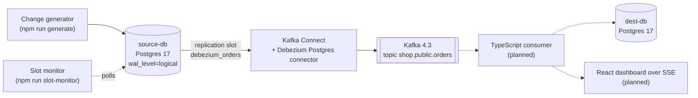

# postgres-kafka-cdc

> **Work in progress.** This is a learning project, not a production system.
> The capture half of the pipeline (Postgres → Debezium → Kafka) works. The consumer,
> the destination writes and the dashboard are not built yet. See [Status](#status).

A local change-data-capture (CDC) pipeline. It streams row-level changes from one
PostgreSQL database to another in near real time, by reading the source database's
write-ahead log (WAL) rather than polling tables or using triggers.



Solid lines are built and verified; dashed lines are planned.

## Status

| Part | State |
|---|---|
| Source Postgres with logical replication, `orders` table | Built |
| Kafka (single node, KRaft mode, no ZooKeeper) | Built |
| Kafka Connect with the Debezium Postgres connector | Built. Registered automatically on `docker compose up`. |
| Snapshot of existing rows, then live inserts/updates/deletes into Kafka | Verified |
| Seeded change generator and shared trace file | Built |
| Replication slot monitor | Built |
| Captured Debezium events as test fixtures | Saved in `fixtures/debezium/` |
| Destination Postgres container | Running; **no schema yet** |
| Consumer writing to the destination idempotently | Planned |
| Latency measurement (p50/p95) | Planned. No numbers yet. |
| React dashboard | Planned |

## Prerequisites

- Docker with Docker Compose v2
- Node.js 24, for the scripts that run on the host (generator, slot monitor). The version
  is pinned in `.node-version`, which version managers such as fnm or nvm read. Node 24
  rather than the newer Node 26 LTS, because the Kafka client used by the consumer ships
  prebuilt native binaries only up to Node 24 (as of `@confluentinc/kafka-javascript` 1.11.0).
- `curl`. On Windows PowerShell, type `curl.exe`, because plain `curl` is an alias for
  `Invoke-WebRequest` there. Git Bash works as-is.

Free host ports needed: 5433, 5434, 8083, 29092, and 8080 for the optional UI.

## Run it

**1. Create your local config.**

```sh
cp .env.example .env
```

`.env` is git-ignored. The defaults are local-only development passwords; change them if
you like. They're only read when the database volumes are first created (see step 2).

**2. Start the stack.**

```sh
docker compose up -d
```

On a fresh volume, the source database runs the scripts in `db/source/init/` once: they
create the `orders` table, the Debezium and monitor roles, and the publication.

Once Kafka Connect is healthy, the one-shot `connect-register` service registers the
Debezium connector from `connect/source-orders.json` and exits. It uses
`PUT /connectors/source-orders/config`, which creates or updates the connector, so it is
safe on every `up`. (`docker compose up --wait` is not used because Compose treats a
container that exits on purpose as a failure.)

**3. Check that the connector is running.** Registration happens after Connect's health
check passes, so give it a moment, then:

```sh
curl http://localhost:8083/connectors/source-orders/status
```

Both `connector.state` and `tasks[0].state` should be `RUNNING`. If not, see what the
registration job said: `docker compose logs connect-register`.

On first start, Debezium creates the replication slot `debezium_orders`, takes a
snapshot of the rows already in `orders`, then streams new changes.

**4. Install the Node dependencies and make some changes.**

```sh
npm install
npm run generate -- --count 20 --seed 1 --delay-ms 250
```

**5. Watch the events arrive.** Either read the topic from the start with Kafka's
console consumer:

```sh
docker compose exec kafka /opt/kafka/bin/kafka-console-consumer.sh \
  --bootstrap-server kafka:9092 --topic shop.public.orders --from-beginning
```

(In Git Bash, prefix that with `MSYS_NO_PATHCONV=1`, otherwise Git Bash rewrites the
`/opt/...` path.)

Or start the optional web UI and browse topics, messages and the connector:

```sh
docker compose --profile tools up -d
```

Then open <http://localhost:8080>. The UI is configured read-only.

**6. Optional: watch the replication slot.**

```sh
npm run slot-monitor
```

It prints the slot's state every 2 seconds and appends it to `logs/trace.jsonl`. Stop it
with Ctrl+C.

**Stop or reset.** `docker compose down` stops everything and keeps the data.
`docker compose down -v` also deletes all volumes, Kafka's included, so the next `up`
starts completely fresh. Avoid resetting *only* the source database volume: Kafka Connect
would keep the connector's saved position, which refers to a replication slot that no
longer exists (see Known limitations).

## What's in it

### Services (`docker-compose.yml`)

| Service | Image | Host port | Purpose |
|---|---|---|---|
| `source-db` | `postgres:17` | 5433 | System of record. `wal_level=logical` makes its WAL decodable into row changes. |
| `dest-db` | `postgres:17` | 5434 | Where the consumer will apply changes. Plain Postgres. |
| `kafka` | `apache/kafka:4.3.1` | 29092 | Single broker that also acts as its own KRaft controller. |
| `connect` | `quay.io/debezium/connect:3.7.1.Final` | 8083 | Kafka Connect runtime with Debezium's connector plugins. Stores its configs, offsets and statuses in Kafka topics, not on disk. |
| `connect-register` | same image as `connect` | none | One-shot job: sends the connector config to Connect, then exits. Reuses the Connect image because it already includes `curl`. |
| `kafka-ui` | `ghcr.io/kafbat/kafka-ui:v1.5.0` | 8080 | Optional (`tools` profile). Read-only web UI. |

### Source database roles

Each process logs in with only the access it needs:

| Role | Can | Used by |
|---|---|---|
| owner (`SOURCE_POSTGRES_USER`) | everything; owns the table and the publication | init scripts, the change generator |
| `debezium` | `LOGIN`, `REPLICATION`, `SELECT` on `orders` only | Debezium |
| `cdc_monitor` | member of `pg_monitor`: reads replication views; no table access | slot monitor |

The publication `cdc_publication` (only `public.orders`) is created by the owner, and
Debezium is configured not to create one. Debezium's password is not in the connector
JSON. It's written as `${env:DEBEZIUM_POSTGRES_PASSWORD}` and filled in by Kafka Connect's
environment-variable config provider when the connector starts.

### Files

| Path | What it is |
|---|---|
| `connect/source-orders.json` | Debezium connector config: `pgoutput` plugin, `public.orders` only, the pre-created publication, slot `debezium_orders`, topic prefix `shop` (topic `shop.public.orders`). |
| `db/source/init/` | Source database setup: table and `updated_at` trigger, Debezium role and publication, monitor role. |
| `src/generator/` | Seeded generator of inserts, updates and deletes. The same seed on the same starting data gives the same operations. |
| `src/slot-monitor/` | Polls `pg_replication_slots` and records lag and retained WAL in bytes. |
| `src/shared/trace.ts` | Shared trace format: one JSON line per pipeline hop, in `logs/trace.jsonl` (git-ignored). Changes are linked across hops by Postgres transaction id and WAL position (LSN). |
| `fixtures/debezium/` | Real Debezium messages (snapshot read, create, update, delete, tombstone) for future consumer tests. |

### npm scripts

| Script | Does |
|---|---|
| `npm run generate -- --count N --seed S --delay-ms D` | Makes N changes to `orders`, one transaction each, and logs each commit to the trace |
| `npm run slot-monitor -- --interval-ms 2000 --slot debezium_orders` | Polls the replication slot until Ctrl+C |
| `npm run typecheck` | Type-checks with `tsc`. Node runs the `.ts` files directly by stripping types, so there is no build step. |

## Design notes

Short versions for now; fuller explanations will come as the project is finished.

- **Log-based CDC with Debezium.** Changes are read from the WAL after commit, so write
  transactions do no extra work and deletes are captured. Polling can miss deletes and
  changes made between polls; triggers add work to every write.
- **Apache Kafka in KRaft mode.** No ZooKeeper. Apache-licensed images only.
- **`REPLICA IDENTITY FULL`** on `orders`, so update and delete events carry the full old
  row. That's useful for inspection, at the cost of more WAL. The consumer will not rely on it.
- **JSON with embedded schemas**, chosen so events are readable while learning. Avro with a
  schema registry was considered and deferred.
- **`decimal.handling.mode=string`.** Debezium's default (`precise`) sends `numeric` as a
  base64-encoded unscaled integer that every consumer would have to decode. As a string
  (`"146.50"`) it stays exact and Postgres accepts it as-is. Rejected: `double`, which is
  lossy for money.
- **Own consumer instead of a ready-made sink connector**, because idempotent writes, offset
  commits and tombstone handling are what this project is meant to teach.

## Known limitations

These are the ones found so far; more will be added as the project grows.

- **Single Kafka broker, replication factor 1.** Losing the broker's volume loses the data.
  Fine locally, not durable.
- **At-least-once delivery.** Kafka Connect saves Debezium's position every 60 seconds by
  default, so a crash can resend up to about a minute of events. The consumer will have to
  be idempotent; that isn't built yet.
- **Large messages.** Every message carries its full schema. In the saved `create` fixture
  the schema takes 2,912 bytes and the row data 613 bytes (compact JSON).
- **Snapshot events can't be traced to the transaction that wrote the row.** Their
  `source.txId` is the snapshot's own transaction.
- **One task per connector.** A Postgres replication slot is a single ordered stream, so the
  Debezium Postgres connector can't spread one slot's work across tasks.
- **A stopped or broken connector makes Postgres keep WAL.** `max_slot_wal_keep_size` is left
  at its default (unlimited), so a dead slot could eventually fill the disk.
- **A recreated slot isn't detected.** Debezium's default offset-mismatch strategy
  (`no_validation`) resumes from the stored position without checking it against the slot,
  so changes in between could be skipped silently.
- **The generator runs one transaction at a time**, so concurrent-transaction ordering
  hasn't been exercised.

## License

[MIT](LICENSE)
